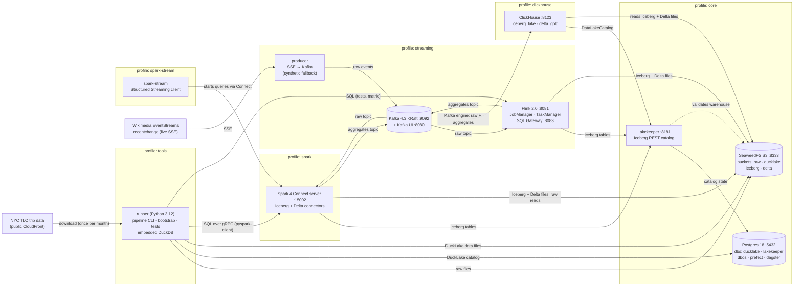
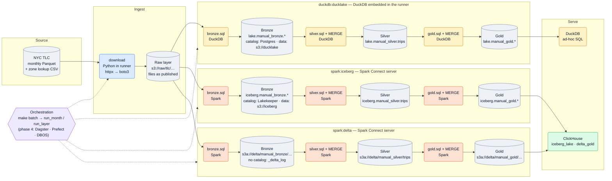
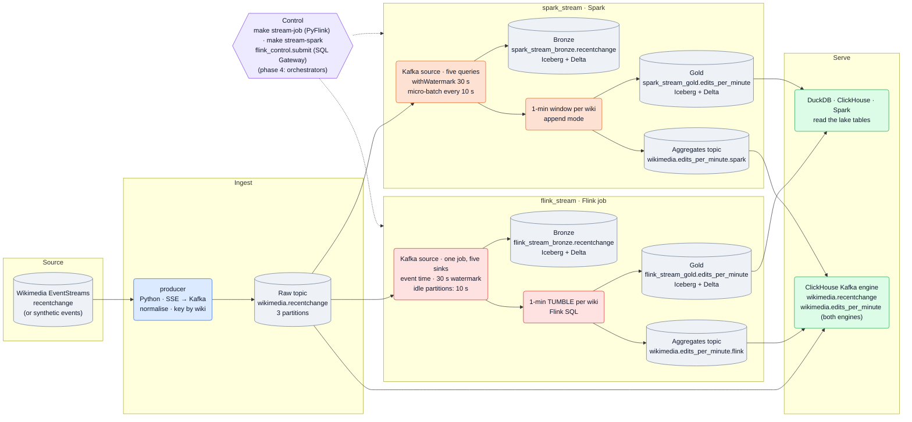
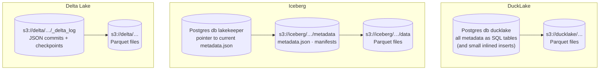

# Architecture

What runs where in the playground, how data moves through it (a month of taxi trips in batch,
a live stream of Wikimedia edits in streaming), and what does the work at each stage.
Diagrams are [Mermaid](https://mermaid.js.org) and render on GitHub; edit them as text.

## Components

<!-- This diagram is also in README.md: keep the two copies in sync. -->

Everything runs in Docker Compose on one machine. Boxes are grouped by Compose profile:
`make up` starts `core`; `make up-batch` adds `spark` and `clickhouse`; `make up-stream` adds
`streaming` (Kafka, the producer, Flink) and `clickhouse`; `tools` is the runner used by `make`
targets. Every published port is bound to `127.0.0.1`.

| Component | Role | Where it's described |
|---|---|---|
| runner | Runs the pipeline (`make batch`), bootstrap and tests on the Compose network. DuckDB is embedded here; Spark work is sent to the Connect server. | `docker/runner/Dockerfile`, `src/de_playground/` |
| Postgres 18 | One instance, one database per tool. Holds the DuckLake catalog and Lakekeeper's state; `dbos`/`prefect`/`dagster` are reserved for phase 4. | `docker/postgres/README.md` |
| SeaweedFS | The only object store. Every format's data files live here. | `docker/seaweedfs/README.md` |
| Lakekeeper | Iceberg REST catalog (warehouse `lakehouse` → bucket `iceberg`). No credential vending: clients bring their own S3 keys. | `docker/lakekeeper/README.md` |
| Spark Connect | Spark 4.0.1 in local mode with Iceberg 1.10 and Delta 4.0; clients only need a thin gRPC client. | `docker/spark/README.md` |
| ClickHouse | Reads the gold tables in place: Iceberg through the Lakekeeper catalog, Delta through `deltaLake()` views. Ingests the Kafka topics with its Kafka engine into `wikimedia.*` tables. | `docker/clickhouse/README.md` |
| Kafka + Kafka UI | One KRaft broker. Topics: `wikimedia.recentchange` (raw) and one aggregates topic per streaming engine. | `docker/kafka/README.md` |
| producer | Reads the live Wikimedia feed (reconnects with `Last-Event-ID`), flattens events, sends them keyed by wiki; switches to synthetic events if the feed is down. | `src/de_playground/streaming/producer.py` |
| Flink | 2.0.1 session cluster with PyFlink and Kafka, Iceberg and Delta connectors. Runs the streaming job; its SQL Gateway lets the runner execute Flink SQL. | `docker/flink/README.md` |
| spark-stream | Starts Spark Structured Streaming queries (the same work as the Flink job) on the Spark Connect server and keeps the session open; stops them on SIGTERM. | `src/de_playground/streaming/spark_stream.py`, `docker/spark/README.md` |

## Processing stages and data layers

Columns are the stages a month of data goes through; rows are the three targets `make batch`
runs. Cylinders are **data at rest** (which layer, which table, where it's stored); rounded boxes
are **processing**, coloured by what does the work: blue = Python in the runner, amber = DuckDB,
orange = Spark, green = ClickHouse, purple = orchestration. Dotted lines are control (what
triggers each step), solid lines are data.

| Stage | What does the work | Code | Reads | Writes | Re-running the month |
|---|---|---|---|---|---|
| **Ingest** | Python in the runner (`httpx` → `boto3`) | `sources/tlc.py` | TLC CloudFront | `s3://raw/tlc/…` | Skipped if the file is already there |
| **Bronze** | DuckDB (DuckLake) or Spark (Iceberg, Delta) | `batch/sql/bronze.sql`, `batch/columns.py` | the month's raw file + zone CSV | `<ns>_bronze.yellow_trips`, `taxi_zones` | Replaces the month (DELETE + INSERT) |
| **Silver** | the same engine | `batch/sql/silver.sql`, `batch/schemas.py` | the month's bronze rows | `<ns>_silver.trips` | MERGE: upsert + delete rows no longer produced |
| **Gold** | the same engine | `batch/sql/gold.sql` | the month's silver rows | `<ns>_gold.daily_zone_stats`, `hourly_borough_demand`, `payment_tip_stats` | MERGE, same as silver |
| **Serve** | ClickHouse for Iceberg/Delta; DuckDB for DuckLake | `clickhouse_setup.py` | gold tables in place | nothing (reads only) | — |

`run_layer` in `batch/pipeline.py` drives each layer: it renders the layer's SQL for the engine,
runs it, then MERGEs the result. Phase 4's orchestrators will call the same function, so this
picture stays the same; only the box at the top changes.

## Streaming stages and data layers

The streaming track in the same style as the batch picture above: columns are stages, rows are
the streaming engines. Both engines read the **same raw topic** and do the same work, each into
its own namespace and aggregates topic, so their output can be compared. Colours as above, plus
red = Flink.

| Stage | What does the work | Code | Reads | Writes | Delivery |
|---|---|---|---|---|---|
| **Ingest** | the `producer` service (Python) | `streaming/producer.py`, `events.py` | Wikimedia SSE (or `synthetic.py`) | `wikimedia.recentchange` | acks=all; resumes with `Last-Event-ID` after a disconnect |
| **Bronze** | Flink or Spark | `streaming/flink/statements.py` | the raw topic, from the job's consumer-group offsets | `<ns>_bronze.recentchange` in Iceberg and Delta, partitioned by `event_date` | exactly-once: both sinks commit on Flink checkpoints (30 s) |
| **Gold** | the same engine | Flink: same · Spark: `streaming/spark_stream.py` | the same source, windowed by event time | `<ns>_gold.edits_per_minute` (Iceberg, Delta) + the engine's aggregates topic | a window is written once, when the watermark passes its end; later events are dropped from it (but are in bronze); Kafka sink is at-least-once |
| **Serve** | DuckDB, ClickHouse, Spark read the lake tables; ClickHouse also ingests the topics | `streaming/clickhouse_streaming.py` | lake tables; raw + both aggregates topics | `wikimedia.recentchange`, `wikimedia.edits_per_minute` (`engine` column) | ReplacingMergeTree collapses Kafka's at-least-once duplicates (query with `FINAL`) |

The streaming job's statements are rendered once by `build_statements` and run either by the
PyFlink entrypoint (`make stream-job`) or through the SQL Gateway (`flink_control.submit`, used by
the tests), so both paths run identical SQL. Spark runs the same logic as DataFrame code in
`spark_stream.py`. A test runs both over the same topic and asserts identical gold, and on the
live feed they matched on every shared window. The differences between the engines are written up in
`docker/flink/README.md` and `docker/spark/README.md`.

| | Flink | Spark Structured Streaming |
|---|---|---|
| Runs as | one job (statement set): Kafka read once, five sinks | five queries, each with its own Kafka read and checkpoint |
| Watermark | **minimum** across partitions; quiet partitions must be marked idle | one **global** watermark (max event time − delay) |
| Commits | on checkpoints (30 s) | per micro-batch (trigger 10 s) |
| Started by | `flink run` / SQL Gateway; runs without a client | a client session (`spark-stream`) that must stay up and stop its queries on exit |

## Where each table format keeps its metadata

The three formats split "catalog" and "data" differently — the main thing the playground
lets you compare.

DuckLake keeps everything except data files in a database; Iceberg keeps metadata as files and
uses the catalog only to find the current version; Delta needs no catalog at all here (tables are
addressed by path).

## Batch data flow (one month)

`make batch` runs this for each month, in order, for each target. The SQL is the same for every
target (`src/de_playground/batch/sql/`); only the engine and table format differ.

```mermaid
flowchart LR
    raw["raw bucket<br/>yellow_tripdata_YYYY-MM.parquet<br/>taxi_zone_lookup.csv"]

    subgraph targets["one target per run"]
        direction TB
        t1["duckdb:ducklake"]
        t2["spark:iceberg"]
        t3["spark:delta"]
    end

    bronze["Bronze<br/>yellow_trips · taxi_zones<br/>normalised schema, all rows kept"]
    silver["Silver<br/>trips<br/>cleaned · trip_id · deduped · zone names"]
    gold["Gold<br/>daily_zone_stats<br/>hourly_borough_demand<br/>payment_tip_stats"]
    ch["ClickHouse<br/>(Iceberg + Delta gold)"]

    raw --> targets
    targets -- "replace the month<br/>(DELETE + INSERT)" --> bronze
    bronze -- "clean · dedup · MERGE<br/>(upsert + delete stale rows)" --> silver
    silver -- "aggregate · MERGE<br/>(upsert + delete stale rows)" --> gold
    gold -. "read in place" .-> ch
```

What each step guarantees:

- **Bronze** replaces the month's rows, so re-running never duplicates. Raw columns are mapped
  onto one schema (TLC files drift between years); missing columns become NULL.
- **Silver** keeps only valid trips whose pickup is inside the month, derives `trip_id`, keeps one
  row per `trip_id` with a deterministic tie-break, joins zone names, then `MERGE`s. Rows the month
  no longer produces are deleted (on DuckLake via a separate `DELETE` in the same transaction,
  since its `MERGE` allows only one update/delete action).
- **Gold** recomputes the month's aggregates from silver and `MERGE`s them the same way.
- Tables are named `{namespace}_{layer}.{table}`; `make batch NS=dev` writes a separate copy.
  Phase 4 orchestrators will each use their own namespace (`dagster`, `prefect`, `dbos`).

## Coming later

Phase 4 adds the orchestrators (Dagster, Prefect, DBOS) wrapping `run_layer`/`run_month`; phase 5
dbt, Debezium and OpenLineage; phase 6 the AI layer (Ollama, LangGraph, NVIDIA Auto Ontology).
See the design doc: `docs/superpowers/specs/2026-11-11-de-playground-design.md`.
