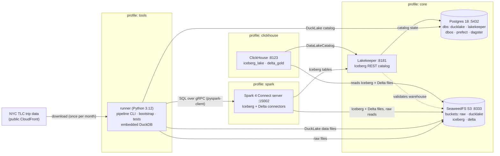
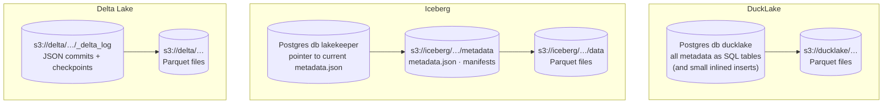

# Architecture

What runs where in the playground (phases 1–2), and how a month of taxi data moves through it.
Diagrams are [Mermaid](https://mermaid.js.org) and render on GitHub; edit them as text.

## Components

<!-- This diagram is also in README.md: keep the two copies in sync. -->

Everything runs in Docker Compose on one machine. Boxes are grouped by Compose profile
(`make up` starts `core`; `make up-batch` adds `spark` and `clickhouse`; `tools` is the runner
used by `make` targets). Every published port is bound to `127.0.0.1`.

| Component | Role | Where it's described |
|---|---|---|
| runner | Runs the pipeline (`make batch`), bootstrap and tests on the Compose network. DuckDB is embedded here; Spark work is sent to the Connect server. | `docker/runner/Dockerfile`, `src/de_playground/` |
| Postgres 18 | One instance, one database per tool. Holds the DuckLake catalog and Lakekeeper's state; `dbos`/`prefect`/`dagster` are reserved for phase 4. | `docker/postgres/README.md` |
| SeaweedFS | The only object store. Every format's data files live here. | `docker/seaweedfs/README.md` |
| Lakekeeper | Iceberg REST catalog (warehouse `lakehouse` → bucket `iceberg`). No credential vending: clients bring their own S3 keys. | `docker/lakekeeper/README.md` |
| Spark Connect | Spark 4.0.1 in local mode with Iceberg 1.10 and Delta 4.0; clients only need a thin gRPC client. | `docker/spark/README.md` |
| ClickHouse | Reads the gold tables in place: Iceberg through the Lakekeeper catalog, Delta through `deltaLake()` views. | `docker/clickhouse/README.md` |

## Where each table format keeps its metadata

The three formats split "catalog" and "data" differently — the main thing the playground
lets you compare.

DuckLake keeps everything except data files in a database; Iceberg keeps metadata as files and
uses the catalog only to find the current version; Delta needs no catalog at all here (tables are
addressed by path).

## Batch data flow (one month)

`make batch` runs this for each month, in order, for each target. The SQL is the same for every
target (`src/de_playground/batch/sql/`); only the engine and table format differ.

```mermaid
flowchart LR
    raw["raw bucket<br/>yellow_tripdata_YYYY-MM.parquet<br/>taxi_zone_lookup.csv"]

    subgraph targets["one target per run"]
        direction TB
        t1["duckdb:ducklake"]
        t2["spark:iceberg"]
        t3["spark:delta"]
    end

    bronze["Bronze<br/>yellow_trips · taxi_zones<br/>normalised schema, all rows kept"]
    silver["Silver<br/>trips<br/>cleaned · trip_id · deduped · zone names"]
    gold["Gold<br/>daily_zone_stats<br/>hourly_borough_demand<br/>payment_tip_stats"]
    ch["ClickHouse<br/>(Iceberg + Delta gold)"]

    raw --> targets
    targets -- "replace the month<br/>(DELETE + INSERT)" --> bronze
    bronze -- "clean · dedup · MERGE<br/>(upsert + delete stale rows)" --> silver
    silver -- "aggregate · MERGE<br/>(upsert + delete stale rows)" --> gold
    gold -. "read in place" .-> ch
```

What each step guarantees:

- **Bronze** replaces the month's rows, so re-running never duplicates. Raw columns are mapped
  onto one schema (TLC files drift between years); missing columns become NULL.
- **Silver** keeps only valid trips whose pickup is inside the month, derives `trip_id`, keeps one
  row per `trip_id` with a deterministic tie-break, joins zone names, then `MERGE`s. Rows the month
  no longer produces are deleted (on DuckLake via a separate `DELETE` in the same transaction,
  since its `MERGE` allows only one update/delete action).
- **Gold** recomputes the month's aggregates from silver and `MERGE`s them the same way.
- Tables are named `{namespace}_{layer}.{table}`; `make batch NS=dev` writes a separate copy.
  Phase 4 orchestrators will each use their own namespace (`dagster`, `prefect`, `dbos`).

## Coming later

Phase 3 adds a streaming track (Kafka, a Wikimedia producer, PyFlink, ClickHouse ingestion);
phase 4 the orchestrators (Dagster, Prefect, DBOS) wrapping `run_layer`/`run_month`; phase 5
dbt, Debezium and OpenLineage; phase 6 the AI layer (Ollama, LangGraph, NVIDIA Auto Ontology).
See the design doc: `docs/superpowers/specs/2026-11-11-de-playground-design.md`.
